# Payment-Propensity Scoring in R

Which accounts are likely to pay next month, which aren't, and how do you know the model still works a few months later?
A logistic-regression scoring model with calibration, score bands and a monthly monitoring report in R Markdown.

| | |
|---|---|
| Data | **Real.** UCI "Default of Credit Card Clients" (Yeh & Lien, 2009, CC BY 4.0): 30,000 credit-card accounts, April–September 2005. Each has monthly repayment status, bill and payment amounts, and whether it defaulted on the October payment (22.1% did) |
| Stack | R 4.3: `data.table`, `glm`, `pROC`, `ggplot2`, `rmarkdown`, `testthat` |
| Model inputs | 9 payment-behaviour features from the 3 months before the scoring month. **No age, sex, education or marital status** |

## 1. Who will pay in October? (held-out accounts)
The model was developed on 21,000 accounts and tested on 9,000 (a stratified 70/30 split).

| | AUC (95% CI) | Defaults in riskiest 10% | Defaults in riskiest 20% |
|---|---|---|---|
| Rule: months behind last month | 0.727 (0.715–0.740) | 32.6% | 50.4% |
| **Logistic regression** | **0.771 (0.759–0.784)** | 32.0% | 50.3% |
| + age, sex, education, marital status | 0.772 (0.760–0.784) | | |

- **The model ranks better overall** (DeLong p < 0.001), **but not at the top.** If collectors can work only the riskiest 10–20% of accounts, last month's status finds as many defaults as the model. The model earns its keep in the middle of the book, e.g. for deciding who gets a reminder and who gets nothing.
- **Demographics add nothing** (AUC +0.001, p = 0.69), so the model leaves them out at no cost.
- **Calibrated:** observed/expected 1.01; each decile within 3.5 points of its predicted default rate; Brier score 0.136 vs. 0.172 for the base rate.

**Score bands** (likelihood to pay; cut points fixed on the development accounts):

| Band | Share of accounts | Paid in October | Predicted to pay |
|---|---|---|---|
| A | 26.0% | 93.1% | 90.3% |
| B | 25.0% | 87.5% | 87.4% |
| C | 24.3% | 80.9% | 82.7% |
| D | 14.9% | 62.7% | 64.1% |
| E | 9.8% | 28.9% | 32.1% |



## 2. Monthly monitoring (real, out of time)
A model developed on July (label: 2+ months behind) was scored in August, September and October, as a monthly
production run would be. `report.Rmd` renders the monthly report (`results/monthly_report_Oct.html`).

| Month | Observed | Predicted | O/E | AUC | Score PSI | Status-input PSI |
|---|---|---|---|---|---|---|
| Jul (development) | 14.0% | 14.0% | 1.00 | 0.865 | – | – |
| Aug | 14.7% | 15.3% | 0.96 | 0.877 | 0.003 | 0.009 |
| Sep | 10.4% | 16.0% | **0.65** | 0.872 | 0.007 | 0.017 |
| Oct (issuer's default flag) | 22.1% | 17.1% | 1.29* | 0.742* | 0.081 | **0.91** |

\*October uses a different label (the issuer's default flag), so it is not comparable with the earlier months.



- **Score PSI never raised a flag** (at most 0.081, under the 0.10 threshold), **but the data had changed.** The
  status code for "1 month late" was used for 0–28 accounts a month from April to August, then for 3,688 in
  September, while "2 months late" fell from 3,927 to 2,667. A jump that size most likely reflects a change in how
  status was recorded rather than in customer behaviour (it can't be confirmed from the data alone).
- **The outcome label moved first:** September observed/expected fell to 0.65 because fewer accounts were coded
  "2+ months behind".
- **Feature-level PSI caught it** the month the new code entered the inputs (0.91, "investigate"). Score-level PSI alone
  would have passed the run, so the report checks both.
- **The model got lucky on the new code:** it treats "1" as one month behind; for those 3,688 accounts it
  predicted 35% default and 34% defaulted. The code never appeared in development, so this isn't validation.

## Run it
```
Rscript R/get_data.R                 # only if data/credit_card_clean.csv is missing
Rscript R/run_analysis.R             # model, bands, monitoring, figures -> results/
Rscript -e 'testthat::test_dir("tests/testthat")'     # 19 checks
Rscript -e 'rmarkdown::render("report.Rmd", output_file = "results/monthly_report_Oct.html")'
```
Needs R ≥ 4.1 with `data.table`, `pROC`, `ggplot2`, `jsonlite`, `rmarkdown`, `knitr`, `testthat`, plus pandoc
(bundled with RStudio).

## Limitations
- **One issuer, Taiwan, 2005,** and only six months of history. The "out of time" test spans three months.
- **Defaulting on one payment isn't the same as "will pay a collections balance".** A collections model would be
  trained on outcomes after contact (promise kept, amount recovered), which this data doesn't have.
- **The split for section 1 is random, not by time,** because all accounts share one outcome month.
- **The status codes −2/−1/0 aren't fully documented** by the data's authors; they're used as the field's
  documented meanings (no balance / paid in full / revolving).
