```{r setup, include = FALSE}
knitr::opts_chunk$set(echo = FALSE, message = FALSE, warning = FALSE)
suppressPackageStartupMessages({ library(data.table); library(jsonlite); library(knitr) })
source("R/functions.R")
res <- fromJSON("results/results.json")
mon <- fread("results/monitoring.csv")
cur <- mon[month == params$month]
pct <- function(x, d = 1) paste0(formatC(100 * x, format = "f", digits = d), "%")
```

**Run month:** `r params$month` · **Model:** logistic regression developed on July 2005 (2+ months behind), 9 payment-behaviour features, no age, sex, education or marital status · **Accounts scored:** `r format(cur$accounts, big.mark = ",")`

## 1. Status at a glance

```{r}
flags <- data.table(
  Check = c("Score distribution (PSI vs. July)", "Repayment-status input (PSI vs. July)",
            "Observed / expected", "Ranking (AUC)"),
  Value = c(sprintf("%.3f", cur$psi_score), sprintf("%.3f", cur$psi_status_1),
            sprintf("%.2f", cur$o_e), sprintf("%.3f", cur$auc)),
  Status = c(psi_flag(cur$psi_score), psi_flag(cur$psi_status_1),
             ifelse(abs(cur$o_e - 1) <= 0.15, "stable", "investigate"),
             ifelse(cur$auc >= 0.75, "stable", "watch")))
kable(flags)
```

Thresholds: PSI below 0.10 stable, 0.10-0.25 watch, above 0.25 investigate; observed/expected outside 0.85-1.15 investigate.

## 2. Month by month

```{r}
kable(mon[, .(Month = month, Label = label, `Observed rate` = pct(observed), `Predicted rate` = pct(predicted),
              `O/E` = round(o_e, 2), AUC = round(auc, 3), `Defaults in riskiest 10%` = pct(capture_top10),
              `Score PSI` = round(psi_score, 3), `Status PSI` = round(psi_status_1, 3),
              `Coded "1 month late"` = pct(share_status_1_eq_1, 2))])
```



## 3. What changed

```{r}
codes <- fread("results/status_codes_by_month.csv")
kable(codes, align = "r", caption = "Accounts by raw repayment-status code and month (source data)")
```

- **The score distribution never moved enough to raise a flag** (score PSI at most `r sprintf("%.3f", max(mon$psi_score))`).
- **The inputs did.** The code for "1 month late" was used for `r codes[status == 1, Aug]` accounts in August and `r format(codes[status == 1, Sep], big.mark = ",")` in September, while the "2 months late" count fell. A jump that size in one month most likely reflects a change in how status was recorded, not in customer behaviour (to be confirmed with the data owner). It pushed the status-input PSI to `r sprintf("%.2f", mon[month == "Oct", psi_status_1])`.
- **September's outcome label was affected first:** observed/expected fell to `r sprintf("%.2f", mon[month == "Sep", o_e])`, because fewer accounts were coded "2+ months behind".
- The model treats the new code as "1 month behind". For the `r format(res$oct_status1$accounts, big.mark = ",")` October accounts carrying it, predicted default was `r pct(res$oct_status1$predicted_status1)` and observed `r pct(res$oct_status1$default_rate_status1)`. That is close, but the code was never seen in development, so it is luck, not validation.
- October's label is the issuer's default flag rather than "2+ months behind", so its observed/expected is not comparable with earlier months.

## 4. Actions

1. Confirm the status-code change with the data owner before the next run.
2. Refit on data after the change (the October-developed model reaches AUC `r sprintf("%.3f", res$october$auc$model[2])` on held-out accounts).
3. Keep feature-level PSI in the report: score PSI alone would have passed this month.
